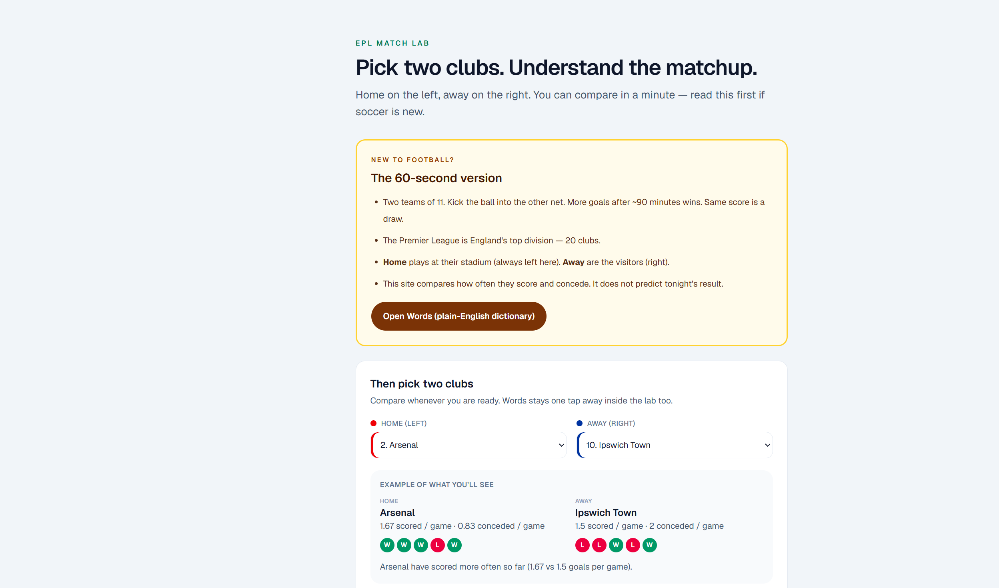
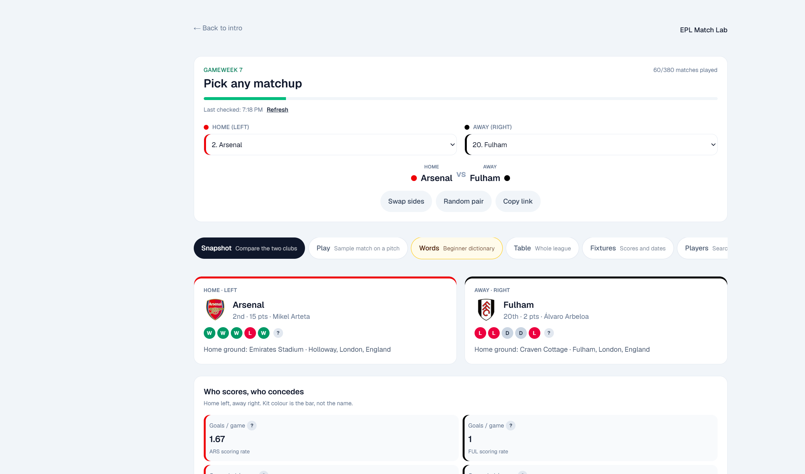
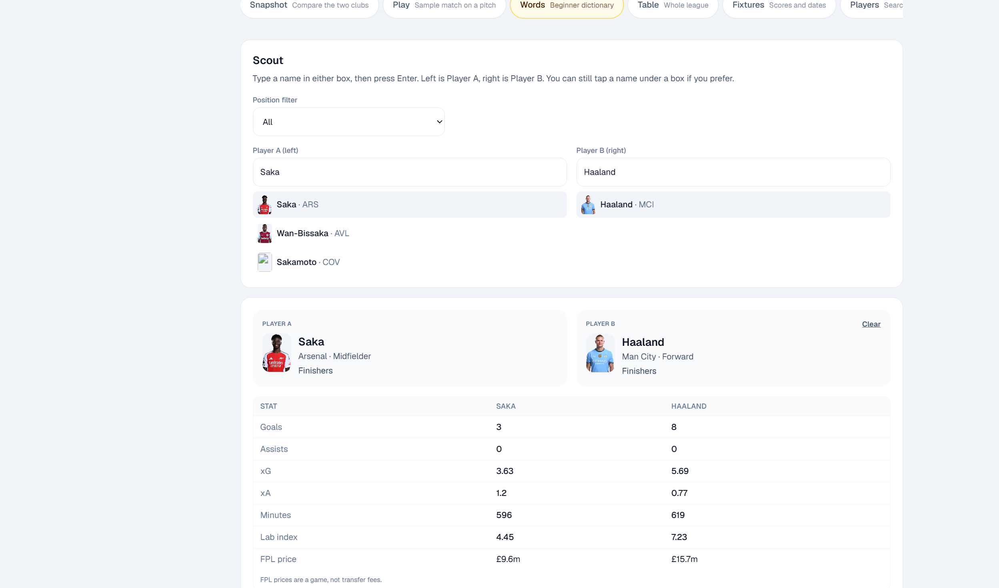

# EPL Match Lab

I watch the Premier League, so I built a public-data lab: compare any two clubs in plain English, a sample match that is not a prediction, and a scout view of similar players. Missing salaries stay blank.

**Live:** [https://epl-match-lab-rho.vercel.app/](https://epl-match-lab-rho.vercel.app/)

This is one Next.js website, not three Streamlit apps. It is an educational lab, not an official Premier League product and not a betting tool.



## Run it

Need Git and Node.js LTS. In this folder:

```bash
npm install
npm run dev
```

On Windows PowerShell, if `npm` is blocked, use `npm.cmd` instead.

Open [http://localhost:3000](http://localhost:3000). Read the yellow **New to football?** card, pick clubs (home left, away right), then **Words first** or **Compare clubs**. In the lab: Snapshot → Play → Scout → Fixtures (kickoff times use your timezone).

The live app is [https://epl-match-lab-rho.vercel.app/](https://epl-match-lab-rho.vercel.app/). Shared lab and Scout links (`/lab?tab=scout&player=Saka`) get Open Graph cards with the clubs or player names — not a generic Next.js title. On Vercel, set `NEXT_PUBLIC_SITE_URL` to that production URL if preview cards need a stable domain.

```bash
npm test
npm run build
```

Stop the site with Ctrl+C in the terminal.

## Screenshots

**Snapshot** — scoring and conceding rates, form, and a short reading.



**Scout** — shareable search (`?tab=scout&player=Saka`), pin a second player, style group on the same page.



## What it does

- Compare any two current Premier League clubs (home always left).
- Show scoring and conceding rates, recent form, and a short reading.
- Play one sample 90 minutes, or roll hundreds of samples from those rates.
- Scout similar players from FPL stats (goals, assists, xG, xA, minutes, clean sheets). Lab index is a toy score, not a transfer fee. Copy the URL — the preview card follows the player.
- Browse the table, a scorers board (goals, assists, xG), fixtures in your timezone, squads, team news (out / doubtful / available), and listed wage notes when they exist.
- Play includes a saved history check from the lab forest: 33% on the last 30 finished matches. Not a tip.
- Explain football words in place (`?` buttons) and in the Words tab.

## Stack

Next.js 16 (App Router), React 19, Tailwind CSS 4, TypeScript.

## Data sources and limits

- **Fantasy Premier League** public JSON: squads, player stats, fixtures, live-ish scores.
- **Wikidata**: coaches, when listed.
- **TheSportsDB**: wages and stadium notes, when listed.

FPL price is a game price, not a salary or transfer fee. If the fixture feed fails, the lab shows an error instead of a table of zeros. Missing coaches, stadiums, wages, or fees stay blank. Squad xG is the sum of current FPL player xG, not a match-by-match club total.

The sample match and 300 rolls use season goals-per-game and goals-conceded-per-game. Percentages describe that model only. They are not a validated forecast and not a tip for Saturday.

Do not scrape Transfermarkt. Do not commit API keys — use a `.env` file (already gitignored). Extra ML notebooks live in [`lab-models/`](lab-models/README.md). They are experiments, not the live website. Football data provided by the Football-Data.org API. Free tier: 10 calls per minute; the lab client reads `X-RequestsAvailable` and caches responses.

## Tests

`npm test` covers standings math, failed fixture requests, duplicate club selection, simulation repeatability, and Scout similarity helpers.
